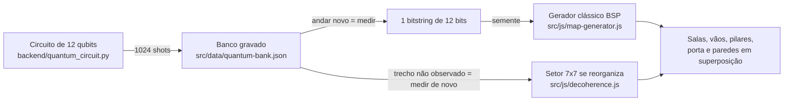

# Conceitos quânticos do jogo

Esta página descreve o que o código faz de verdade e separa a física das
mecânicas de jogo. O mesmo conteúdo aparece no telão de slides do lobby
(`src/js/content/quantum-slides.js`).

## Do circuito ao mapa

## Labirinto em tempo real (decoerência)

O labirinto muda sozinho enquanto você joga, mas só onde ninguém está olhando.

- O mapa é dividido em setores de 7 x 7 células (`listSectors`).
- A cada 0,2 s o jogo marca como **observado** todo setor que está a até 2,5
  células do jogador ou que tem alguma célula no campo de visão (até 75° do
  centro e 16 células) com linha de visão livre (`isSectorObserved`).
- Um setor que fica **18 s sem ser observado** volta à superposição: o jogo
  tira uma nova medição do banco do andar e usa esse bitstring para montar o
  setor de novo (`reshuffleSector`): sala aberta, paredes com vãos ou pilares.
  No máximo uma troca a cada 9 s.
- Antes de trocar, o jogo confere de novo que o setor não está à vista. O que
  você está vendo nunca muda: observar é medir.
- A troca é local e segura: só as células do setor mudam, porta, itens,
  jogador e entidade ficam livres, e o labirinto inteiro continua conectado
  (se não der, o setor vira uma sala aberta).
- O aviso é sutil: a tela escurece de leve, um zumbido grave passa e, nas duas
  primeiras vezes, aparece uma dica.
- O lobby (fase 0) não muda.

## QPS: o mapa do andar

Pegar o QPS é a medição do andar. Ele não refaz mais o labirinto: grava a
planta daquele instante e revela a porta.

- **Ver o mapa:** pulso direito (VR) ou M (desktop). Mostra paredes, paredes em
  superposição (roxo), a porta (amarelo) e você (seta branca).
- **Mapa desatualizado:** os setores que se reorganizaram depois da leitura
  aparecem chiando, com um "?".
- **Nova leitura:** pinça com a mão esquerda perto do mapa (VR) ou R (desktop).
  Custa 10 de energia.
- No lobby, o QPS de treino também vira mapa (do lobby, que não muda).

## Conceito por conceito

| Conceito | No circuito / código | No jogo |
| --- | --- | --- |
| Superposição | `RY(θ)` em cada qubit define a chance de dar 1 | Cada andar é um estado de 12 qubits até ser medido |
| Emaranhamento | `CX(i, i+1)` em cadeia correlaciona vizinhos | Os bits medidos vêm correlacionados, não independentes |
| Interferência e fase | Segunda camada de `RY` e anel de `CZ` | Alguns bitstrings (mapas) são bem mais prováveis |
| Medição e colapso | Sorteio de 1 resultado entre os shots gravados (`measureFromBank`) | Cada andar nasce de uma medição; pegar o QPS grava a planta (mapa) e revela a porta |
| Decoerência | Metáfora: sem observação, a medição "se perde" | Setores não observados por 18 s são medidos de novo e se reorganizam |
| Entropia | Shannon dos `counts` (`shannonEntropy`), 0 a 12 bits | Andares gravados ficam entre ~7 e 8 bits |
| Tunelamento | Metáfora | Salto de fase: atravessa até 2 células de parede, 92% de sucesso, custa 25 de energia e 3 de sanidade |
| Superposição de parede | Metáfora (`isSuperposedOpen` oscila no tempo) | Visor Zeta mostra o estado; entrar na parede aberta a mede e ela fica aberta até você sair (`observeSuperposedWalls`) |

## O que é real e o que é jogo

- **Real:** o circuito de 12 qubits, a amostragem dos seus resultados e a
  entropia calculada das medições. Hoje o banco vem de simulação exata
  (statevector, 1024 shots por andar); com `?live` o jogo chama a API.
- **Clássico:** a construção do mapa. O bitstring é só a semente do gerador
  BSP: o quântico escolhe *qual* dos 4096 mapas aparece, e o mesmo bitstring
  sempre gera o mesmo mapa. A reorganização dos setores também é clássica, com
  um bitstring novo do banco como semente.
- **Metáfora:** a decoerência do labirinto. Na física, decoerência é o
  ambiente apagando a superposição; aqui usamos a ideia ao contrário, como
  regra de jogo: o que ninguém observa "esquece" a medição e muda.
- **Mecânica de jogo:** entidade, sanidade, energia, a oscilação das paredes
  em superposição e os índices de QPS, coerência e ruído do HUD
  (`analyzeQuantumState`, heurísticas calculadas a partir dos bits).
- **Plano B:** se o banco não carrega, `sampleQuantumBitstring` gera bits
  clássicos que imitam a correlação entre vizinhos do CX. Não é medição.

## Onde fica cada parte

| Pasta / arquivo | Responsabilidade |
| --- | --- |
| `src/js/map-generator.js` | Bitstring → labirinto (BSP), porta, lobby fixo |
| `src/js/maze-physics.js` | Grade, colisão, salto de fase, paredes em superposição |
| `src/js/quantum-bank.js` | Leitura do banco, amostragem, entropia |
| `src/js/quantum-measurement.js` | Medição ao pegar o QPS e HUD |
| `src/js/decoherence.js` | Setores, observação, reorganização de um setor (testado em `tests/decoherence.test.js`) |
| `src/js/components/maze-decoherence.js` | Troca em tempo real, aviso (luz e zumbido) |
| `src/js/components/qps-map.js` | Mapa do QPS no pulso direito / tecla M |
| `src/js/content/` | Textos do lobby e dos slides |
| `src/js/components/lobby/` | Montagem do lobby, móveis, computador, paredes de treino, slides |
| `src/js/components/` | Demais componentes A-Frame (mapa, entidade, mãos, HUD) |
