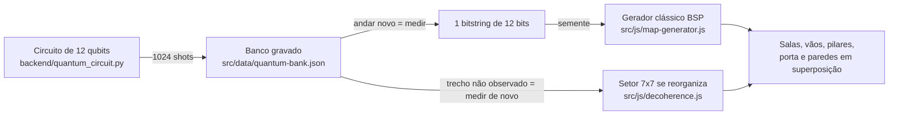

# Conceitos quânticos do jogo

Esta página descreve o que o código faz de verdade e separa a física das
mecânicas de jogo. O mesmo conteúdo aparece no telão de slides do lobby
(`src/js/content/quantum-slides.js`).

## Do circuito ao mapa

## Labirinto em tempo real (efeito Zeno)

O labirinto evolui enquanto você joga, mas só onde ninguém está medindo.

- **Efeito Zeno quântico:** um sistema medido muitas vezes seguidas quase não
  muda, porque cada medição o devolve ao estado medido. Quando as medições
  param, ele volta a evoluir para uma superposição, e a próxima medição pode
  dar outro resultado. É isso que o jogo encena.
- **Quem mede:** o QPS, num raio de 4 células (~4,2 m) ao redor do jogador, e
  os olhos (setor com alguma célula no campo de visão, até 75° do centro e
  16 células, com linha de visão livre). Sem QPS, o raio cai para 2,5 células.
- O mapa é dividido em setores de 7 x 7 células (`listSectors`). Um setor que
  fica **18 s sem ser medido** recebe uma nova medição do banco do andar e é
  montado de novo com esse bitstring (`reshuffleSector`): sala aberta, paredes
  com vãos ou pilares. No máximo uma troca a cada 9 s.
- Antes de trocar, o jogo confere de novo que o setor não está sendo medido.
- A troca é local e segura: só as células do setor mudam, porta, itens,
  jogador e entidade ficam livres, e o labirinto inteiro continua conectado
  (se não der, o setor vira uma sala aberta).
- O aviso é sutil: a tela escurece de leve, um zumbido grave passa e, nas duas
  primeiras vezes, aparece uma dica.
- O raio, os 18 s e os setores são regras de jogo; a física real não tem um
  "relógio" de 18 s. O lobby (fase 0) não muda.

## QPS: o mapa que mede

- O lobby tem três estações de equipamento, cada uma com sua mesa e painel:
  **1. Q-LINK** (relógio, painel do pulso esquerdo / H), **2. Visor Zeta**
  (óculos, pinça na testa / Z) e **3. QPS** (chip, logo depois, na mesma
  parede; o telão de slides fica na parede do fundo). Cada item só funciona depois de pego na sua estação (encostar a mão,
  pinça, Q ou clique) e fica com o jogador em todos os andares. A porta do lobby
  só abre com os três e depois de ler a missão no computador da mesa. Jogo
  novo devolve os itens às mesas.
- **Medição contínua:** a cada 0,2 s o QPS copia para o mapa tudo o que está
  no raio. Não existe mais QPS espalhado pelos andares nem "nova leitura".
- **Mapa** (pulso direito no VR, M no desktop): claro = medindo agora;
  apagado = última leitura; chiando com "?" = o setor evoluiu depois da
  última leitura. O círculo tracejado é o raio de medição. Paredes em
  **azul** dá para atravessar com o Salto de Fase (X); em **roxo** estão em
  superposição (Visor Zeta, Z), e o roxo fica mais forte com o visor ligado.
- **Porta (medição de verdade):** cada andar começa com a porta em
  superposição entre até 4 posições possíveis, afastadas umas das outras
  (`findDoorCandidates`). No mapa elas piscam em amarelo tracejado. Quando
  qualquer uma entra no raio do QPS (2 células sem QPS), o estado é medido
  (`measureFromBank`) e o bitstring medido escolhe onde a porta fica
  (`pickDoorCandidate`). Ela pode aparecer bem ali ou em outro ponto do andar.
  Depois de medida, não muda mais de lugar.

## Conceito por conceito

| Conceito | No circuito / código | No jogo |
| --- | --- | --- |
| Superposição | `RY(θ)` em cada qubit define a chance de dar 1 | Cada andar é um estado de 12 qubits até ser medido |
| Emaranhamento | `CX(i, i+1)` em cadeia correlaciona vizinhos | Os bits medidos vêm correlacionados, não independentes |
| Interferência e fase | Segunda camada de `RY` e anel de `CZ` | Alguns bitstrings (mapas) são bem mais prováveis |
| Medição e colapso | Sorteio de 1 resultado entre os shots gravados (`measureFromBank`) | Cada andar nasce de uma medição; a porta fica entre várias posições até o QPS medir, e a medição sorteia uma |
| Efeito Zeno | Medir sem parar impede a evolução do estado | O raio do QPS congela o labirinto; fora dele, setores sem medição por 18 s evoluem e são medidos de novo |
| Entropia | Shannon dos `counts` (`shannonEntropy`), 0 a 12 bits | Andares gravados ficam entre ~7 e 8 bits |
| Tunelamento | Metáfora | Salto de fase: atravessa até 2 células de parede, 92% de sucesso, custa 25 de energia e 3 de sanidade |
| Superposição de parede | Metáfora (`isSuperposedOpen` oscila no tempo) | Visor Zeta mostra o estado; entrar na parede aberta a mede e ela fica aberta até você sair (`observeSuperposedWalls`) |

## O que é real e o que é jogo

- **Real:** o circuito de 12 qubits, a amostragem dos seus resultados e a
  entropia calculada das medições. Hoje o banco vem de simulação exata
  (statevector, 1024 shots por andar); com `?live` o jogo chama a API.
- **Clássico:** a construção do mapa. O bitstring é só a semente do gerador
  BSP: o quântico escolhe *qual* dos 4096 mapas aparece, e o mesmo bitstring
  sempre gera o mesmo mapa. A reorganização dos setores também é clássica, com
  um bitstring novo do banco como semente.
- **Inspirado na física:** o labirinto que só evolui longe do QPS segue a
  ideia do efeito Zeno quântico; o raio, os 18 s e os setores são regras de
  jogo.
- **Mecânica de jogo:** entidade, sanidade, energia, a oscilação das paredes
  em superposição e os índices de QPS, coerência e ruído do HUD
  (`analyzeQuantumState`, heurísticas calculadas a partir dos bits).
- **Plano B:** se o banco não carrega, `sampleQuantumBitstring` gera bits
  clássicos que imitam a correlação entre vizinhos do CX. Não é medição.

## Onde fica cada parte

| Pasta / arquivo | Responsabilidade |
| --- | --- |
| `src/js/map-generator.js` | Bitstring → labirinto (BSP), posições possíveis da porta e sorteio na medição, lobby fixo |
| `src/js/maze-physics.js` | Grade, colisão, salto de fase, paredes em superposição |
| `src/js/quantum-bank.js` | Leitura do banco, amostragem, entropia |
| `src/js/quantum-measurement.js` | Medição ao pegar o QPS e HUD |
| `src/js/decoherence.js` | Setores, observação, reorganização de um setor (testado em `tests/decoherence.test.js`) |
| `src/js/components/maze-decoherence.js` | Troca em tempo real fora do raio do QPS, aviso (luz e zumbido) |
| `src/js/components/qps-map.js` | Medição contínua do QPS e mapa no pulso direito / tecla M |
| `src/js/content/` | Textos do lobby e dos slides |
| `src/js/components/lobby/` | Montagem do lobby, móveis, computador, paredes de treino, slides |
| `src/js/components/` | Demais componentes A-Frame (mapa, entidade, mãos, HUD) |
