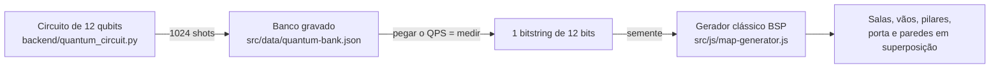

# Conceitos quânticos do jogo

Esta página descreve o que o código faz de verdade e separa a física das
mecânicas de jogo. O mesmo conteúdo aparece no telão de slides do lobby
(`src/js/content/quantum-slides.js`).

## Do circuito ao mapa

| Conceito | No circuito / código | No jogo |
| --- | --- | --- |
| Superposição | `RY(θ)` em cada qubit define a chance de dar 1 | Cada andar é um estado de 12 qubits até ser medido |
| Emaranhamento | `CX(i, i+1)` em cadeia correlaciona vizinhos | Os bits medidos vêm correlacionados, não independentes |
| Interferência e fase | Segunda camada de `RY` e anel de `CZ` | Alguns bitstrings (mapas) são bem mais prováveis |
| Medição e colapso | Sorteio de 1 resultado entre os shots gravados (`measureFromBank`) | Pegar o QPS redesenha o labirinto com esse bitstring |
| Entropia | Shannon dos `counts` (`shannonEntropy`), 0 a 12 bits | Andares gravados ficam entre ~7 e 8 bits |
| Tunelamento | Metáfora | Salto de fase: atravessa até 2 células de parede, 92% de sucesso, custa 25 de energia e 3 de sanidade |
| Superposição de parede | Metáfora (`isSuperposedOpen` oscila no tempo) | Visor Zeta mostra o estado; entrar na parede aberta a mede e ela fica aberta até você sair (`observeSuperposedWalls`) |

## O que é real e o que é jogo

- **Real:** o circuito de 12 qubits, a amostragem dos seus resultados e a
  entropia calculada das medições. Hoje o banco vem de simulação exata
  (statevector, 1024 shots por andar); com `?live` o jogo chama a API.
- **Clássico:** a construção do mapa. O bitstring é só a semente do gerador
  BSP: o quântico escolhe *qual* dos 4096 mapas aparece, e o mesmo bitstring
  sempre gera o mesmo mapa.
- **Mecânica de jogo:** entidade, sanidade, energia, a oscilação das paredes
  em superposição e os índices de QPS, coerência e ruído do HUD
  (`analyzeQuantumState`, heurísticas calculadas a partir dos bits).
- **Plano B:** se o banco não carrega, `sampleQuantumBitstring` gera bits
  clássicos que imitam a correlação entre vizinhos do CX. Não é medição.

## Onde fica cada parte

| Pasta / arquivo | Responsabilidade |
| --- | --- |
| `src/js/map-generator.js` | Bitstring → labirinto (BSP), porta, lobby fixo |
| `src/js/maze-physics.js` | Grade, colisão, salto de fase, paredes em superposição |
| `src/js/quantum-bank.js` | Leitura do banco, amostragem, entropia |
| `src/js/quantum-measurement.js` | Medição ao pegar o QPS, piscar e HUD |
| `src/js/content/` | Textos do lobby e dos slides |
| `src/js/components/lobby/` | Montagem do lobby, móveis, computador, paredes de treino, slides |
| `src/js/components/` | Demais componentes A-Frame (mapa, entidade, mãos, HUD) |
